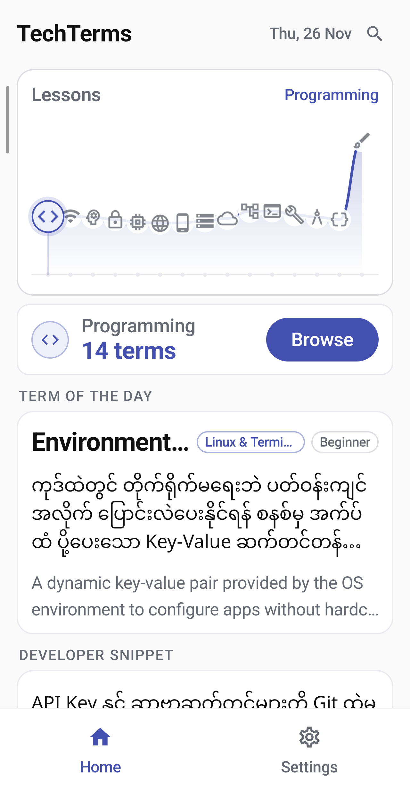
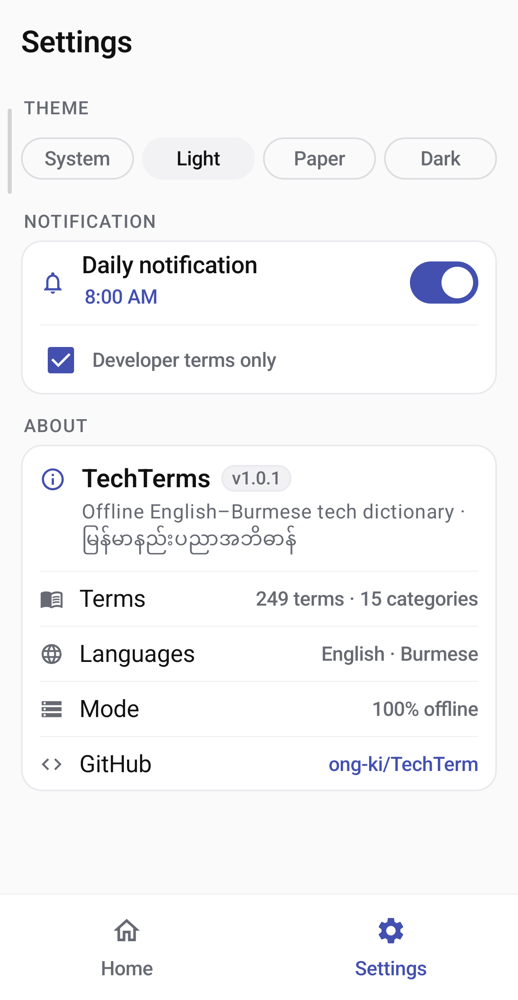
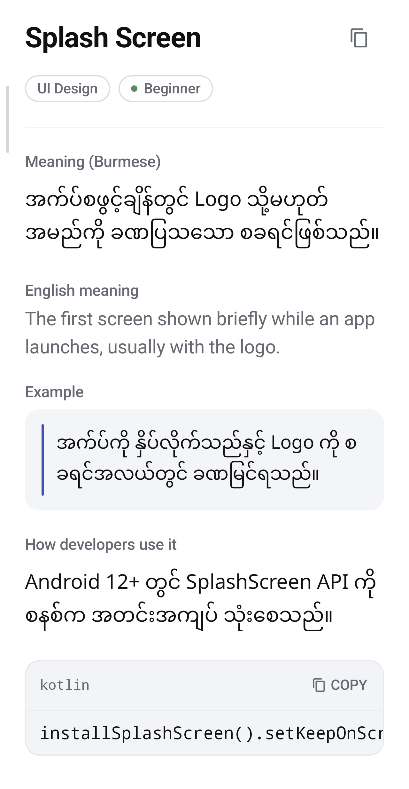

# TechTerms — Offline Burmese Tech Dictionary & Myanmar Programming Terms App

TechTerms is a fast, 100% offline **Burmese Tech Dictionary** and **Android Tech Terms App** built with Kotlin and Jetpack Compose for Myanmar developers, students, and IT learners. Master 249+ **Myanmar programming terms** and **Computer Science dictionary Myanmar** concepts with bilingual Burmese–English explanations, syntax-highlighted code snippets, and daily learning reminders.

<p align="left">
  
  
  
  
  
  <a href="https://github.com/ong-ki/TechTerm/releases/latest">
    
  </a>
</p>

> **မြန်မာဘာသာဖြင့် နည်းပညာဝေါဟာရများ (Myanmar IT Terminology):** Programming, Networking, AI, Security, Cloud, Mobile, Database နှင့် Web Development စသည့် ကဏ္ဍ ၁၅ ခုမှ ဝေါဟာရ ၂၄၉ ခုကျော်ကို အင်တာနက်မလိုဘဲ (Offline) အသုံးပြုလေ့လာနိုင်ပါသည်။

---

## Screenshots — Android Tech Terms App Showcase

| Home & Category Wave Graph | Search & Filter (`249 terms`) | Term Detail & Syntax Highlighting | Settings, Themes (Paper/Dark/Light) & About |
| :---: | :---: | :---: | :---: |
|  |  |  |  |

---

## Key Features — Computer Science Dictionary Myanmar

- **100% Offline Tech Dictionary (အင်တာနက်မလို):** Bundled local JSON seed synced into Room SQLite (`249` terms across `15` categories), ready anywhere with zero network latency.
- **Bilingual Definitions (မြန်မာ + English):** Clear, concise explanations in both Burmese (rendered with bundled `Noto Sans Myanmar` fonts for clean diacritic/subscript spacing) and English, paired with real-world usage examples.
- **Real Code Snippets with Syntax Highlighting:** Developer-focused entries include practical Kotlin, SQL, HTTP, Bash, Git, and Docker snippets with built-in keyword/string/comment highlighting and one-tap copy.
- **Interactive Category Wave Graph:** Explore term counts across 15 CS & engineering categories (`Programming`, `Networking`, `AI`, `Security`, `Hardware`, `Web`, `Mobile`, `Database`, `Cloud`, `Git & Version Control`, `Linux & Terminal`, `DevOps`, `Software Design`, `Data & Formats`, `UI Design`) with animated category icons and quick-jump filtering.
- **Instant Search & Filtering:** Search across term titles, Burmese meanings, English definitions, and code snippets, or filter by category and **Has code**.
- **Daily Term Notifications:** Configurable daily reminder scheduled via WorkManager, with an option to pick **Developer terms only** (terms containing code examples).
- **Four Reading Themes (Paper / Dark / Light / System):** Includes a warm **Paper Mode** with serif headings and subtle canvas paper grain alongside crisp Light and OLED-friendly Dark modes.

---

## Tech Stack & Architecture

| Layer | Technology |
| :--- | :--- |
| **Language** | Kotlin `2.0.21` |
| **UI Toolkit** | Jetpack Compose (`BOM 2024.10.01`), Material 3, Navigation Compose |
| **Local Database** | Room `2.6.1` (KSP) |
| **Async & State** | Kotlin Coroutines & `StateFlow` / `Flow` (`1.9.0`) |
| **Preferences** | Jetpack DataStore Preferences `1.1.1` |
| **Background Work** | WorkManager `2.10.0` + `BootReceiver` |
| **Serialization** | `kotlinx.serialization` JSON `1.7.3` |
| **Min / Target SDK** | API `26` (Android 8.0) / API `35` |

### Project Structure

```text
app/src/main/
├── assets/terms.json                 # Bundled bilingual dictionary dataset (249 terms)
└── java/com/techterms/app/
    ├── data/
    │   ├── datastore/                # Notification & theme preferences (DataStore)
    │   ├── db/                       # Room entity, DAO, migrations, database
    │   └── repository/               # TermRepository (asset seeding & queries)
    ├── notification/                 # DailyTermWorker, BootReceiver, scheduler & helper
    └── ui/
        ├── browse/                   # Search, category chips, and filtered term list
        ├── detail/                   # TermDetailBottomSheet & SyntaxHighlighter
        ├── home/                     # HomeScreen, WaveGraph, ThemeModeSelector
        ├── navigation/               # TechTermsNavGraph (Home, Settings, Browse)
        ├── settings/                 # SettingsScreen (Theme, Notification, About)
        └── theme/                    # Material 3 themes, PaperGrain, Noto Sans Myanmar
```

---

## Download & Installation

1. Open the [**Latest GitHub Release**](https://github.com/ong-ki/TechTerm/releases/latest) page.
2. Download the attached signed [`app-release.apk`](https://github.com/ong-ki/TechTerm/releases/latest) file on your Android device (Android 8.0 / API 26+).
3. Allow installation from your browser/file manager if prompted, then install and open **TechTerms**.

---

## Build Instructions (For Developers)

### Prerequisites
- Android Studio Ladybug (or newer) / JDK 17
- Android SDK Platform 35

### Clone & Build

```bash
git clone https://github.com/ong-ki/TechTerm.git
cd TechTerm

# Build debug APK
./gradlew assembleDebug

# Install directly to a connected ADB device
./gradlew installDebug

# Build release APK
./gradlew assembleRelease
```

---

## Contributing

Contributions to expand **Myanmar IT Terminology**, improve Burmese translations, or refine code snippets are welcome:

1. Fork the repository and create a feature branch (`git checkout -b feat/add-terms`).
2. Add or update entries in `app/src/main/assets/terms.json` and bump `CURRENT_DATA_VERSION` in `TermRepository.kt` if updating existing terms.
3. Verify compilation with `./gradlew compileDebugKotlin` and open a Pull Request.

---

## License

This project is open source and available under the **MIT License** (see `LICENSE` if included in your repository).
